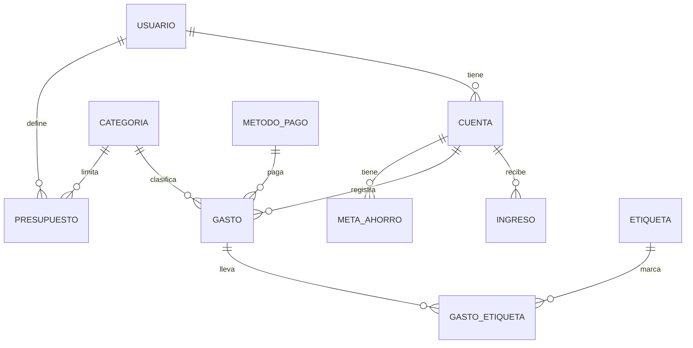

# Gestor de Gastos — API REST con .NET y MariaDB

API REST para administrar las finanzas personales de varios usuarios: cuentas, ingresos, gastos, categorías, etiquetas, presupuestos y metas de ahorro. Incluye **9 recursos con CRUD completo**, **6 servicios que no son CRUD** y un servicio adicional de **contraseñas con hash**.

Proyecto universitario desarrollado con ASP.NET Core, ADO.NET (MySqlConnector) y MariaDB.

## Contenido

1. [Tecnologías](#tecnologías)
2. [Arquitectura y estructura del proyecto](#arquitectura-y-estructura-del-proyecto)
3. [Modelo de datos](#modelo-de-datos)
4. [Puesta en marcha](#puesta-en-marcha)
5. [Endpoints CRUD](#endpoints-crud)
6. [Servicios no CRUD](#servicios-no-crud)
7. [Servicio de contraseñas con hash](#servicio-de-contraseñas-con-hash)
8. [Datos de ejemplo y resultados esperados](#datos-de-ejemplo-y-resultados-esperados)
10. [Estado del proyecto](#estado-del-proyecto)

## Tecnologías

| Componente | Detalle |
|---|---|
| Lenguaje y framework | C# con ASP.NET Core Web API (`[VERSIÓN DE .NET]`) |
| IDE | Visual Studio 2026 |
| Base de datos | MariaDB (incluida en XAMPP) |
| Acceso a datos | ADO.NET con el paquete NuGet **MySqlConnector** (consultas SQL escritas a mano y siempre parametrizadas) |
| Pruebas | Postman |

## Arquitectura y estructura del proyecto

La API sigue una arquitectura por capas. Cada petición recorre las capas en este orden, y cada una crea la siguiente en su constructor:

```
Postman → Controller → Service → Repository → MariaDB
```

| Capa | Responsabilidad |
|---|---|
| **Controllers** | Reciben la petición HTTP y devuelven la respuesta |
| **Services** | Reglas de negocio (validaciones, cálculos, hash de contraseñas) |
| **Repositories** | Único lugar donde se escribe SQL y se habla con la base de datos |
| **Models** | Clases del dominio y objetos de petición/respuesta |

```
GestorDeGastos/
├── Controllers/        # un controlador por entidad + Reporte y Transferencia
├── Models/             # entidades y clases de respuesta
├── Repositories/       # acceso a datos (ADO.NET)
├── Services/           # lógica de negocio y HashService
├── Database/           # script SQL de la base de datos
├── Postman/            # colección de pruebas
├── appsettings.json
└── Program.cs
```

## Modelo de datos

La base de datos se llama `gestor_gastos` y tiene 10 tablas. Los nombres de las columnas coinciden con las propiedades de las clases de C#. Las tablas de varias palabras usan guion bajo: `metodo_pago`, `meta_ahorro` y `gasto_etiqueta`.



| Tabla | Columnas principales |
|---|---|
| `usuario` | Id, Nombre, Apellido, Documento (único), Correo, ContrasenaHash |
| `cuenta` | Id, Nombre, NumeroCuenta (único), Saldo, UsuarioId |
| `categoria` | Id, Nombre |
| `metodo_pago` | Id, Nombre |
| `etiqueta` | Id, Nombre |
| `ingreso` | Id, Descripcion, Valor, Fecha, CuentaId |
| `gasto` | Id, Descripcion, Valor, Fecha, MetodoPagoId, CategoriaId, CuentaId |
| `presupuesto` | Id, ValorLimite, FechaInicio, FechaFin, CategoriaId, UsuarioId |
| `meta_ahorro` | Id, Nombre, MontoObjetivo, MontoActual, FechaLimite, CuentaId |
| `gasto_etiqueta` | Id, GastoId, EtiquetaId (pareja única) |

Notas del modelo:

- Todo el dinero usa `DECIMAL(18,2)` en la base de datos y `decimal` en C#.
- `gasto_etiqueta` resuelve la relación muchos a muchos entre gastos y etiquetas. Sus dos claves foráneas tienen `ON DELETE CASCADE`: al borrar un gasto o una etiqueta, se eliminan sus asignaciones.
- Las demás claves foráneas impiden borrar un registro que todavía esté en uso (por ejemplo, una categoría con gastos).

## Puesta en marcha

### Requisitos

- **XAMPP** (con MariaDB/MySQL).
- **Visual Studio 2026** con la carga de trabajo de ASP.NET, o el SDK de .NET `[VERSIÓN DE .NET]`.
- **Postman** (se recomienda la aplicación de escritorio, porque la versión web no puede llamar a `localhost` sin el *Desktop Agent*).

### Pasos

1. **Clonar** el repositorio: `[URL DEL REPOSITORIO]`.
2. **Iniciar MariaDB:** abre el *XAMPP Control Panel* y haz clic en **Start** en la fila del módulo **MySQL**.
3. **Crear la base de datos:** en esa misma fila, haz clic en **Admin** para abrir phpMyAdmin. Sin seleccionar ninguna base de datos, abre la pestaña **Importar**, elige el archivo `Database/gestor_gastos.sql` y haz clic en **Continuar**.
4. **Abrir la solución** (`GestorDeGastos.sln`) en Visual Studio. Los paquetes NuGet se restauran solos al compilar.
5. **Ejecutar** con el botón verde de inicio. Se abre una ventana de consola que muestra las direcciones donde escucha la API, en las líneas `Now listening on`. En el equipo del autor son `https://localhost:7186` y `http://localhost:5198`; si en tu equipo son distintas, usa las que muestre la consola.
6. **Probar:** importa la colección de la carpeta `Postman/` y define la variable de colección `baseUrl` con la dirección base (por ejemplo, `https://localhost:7186`).

> La cadena de conexión (`Server=localhost;Port=3306;Database=gestor_gastos;User=root;Password=;`) está escrita en el constructor de cada repositorio y corresponde a la configuración por defecto de XAMPP. Si tu MariaDB usa otro usuario, contraseña o puerto, cámbiala allí.

## Endpoints CRUD

Cada uno de los 9 recursos tiene las mismas cinco operaciones:

| Método | Ruta | Descripción | Respuesta |
|---|---|---|---|
| `GET` | `api/{Recurso}` | Listar todos | Lista de objetos |
| `GET` | `api/{Recurso}/{id}` | Obtener uno | El objeto, o respuesta vacía si no existe |
| `POST` | `api/{Recurso}` | Crear | El id generado |
| `PUT` | `api/{Recurso}/{id}` | Actualizar | `true` si existía, `false` si no |
| `DELETE` | `api/{Recurso}/{id}` | Eliminar | `true` si existía, `false` si no |

Campos del cuerpo JSON de `POST` y `PUT` (todos son obligatorios):

| Recurso | Campos |
|---|---|
| `Categoria`, `MetodoPago`, `Etiqueta` | `id`, `nombre` |
| `Usuario` | `id`, `nombre`, `apellido`, `documento`, `correo`, `contrasenaHash` |
| `Cuenta` | `id`, `nombre`, `numeroCuenta`, `saldo`, `usuarioId` |
| `Ingreso` | `id`, `descripcion`, `valor`, `fecha`, `cuentaId` |
| `Gasto` | `id`, `descripcion`, `valor`, `fecha`, `metodoPagoId`, `categoriaId`, `cuentaId` |
| `Presupuesto` | `id`, `valorLimite`, `fechaInicio`, `fechaFin`, `categoriaId`, `usuarioId` |
| `MetaAhorro` | `id`, `nombre`, `montoObjetivo`, `montoActual`, `fechaLimite`, `cuentaId` |

Convenciones:

- Las **fechas** se envían como texto `"AAAA-MM-DD"`, por ejemplo `"2026-10-31"`.
- En un `POST`, el `id` del cuerpo se ignora: lo asigna la base de datos (`AUTO_INCREMENT`).
- En un `PUT`, manda el `id` de la dirección, no el del cuerpo.

Ejemplo (`POST api/Gasto`):

```json
{
  "id": 0,
  "descripcion": "Almuerzo",
  "valor": 25000.00,
  "fecha": "2026-10-31",
  "metodoPagoId": 2,
  "categoriaId": 2,
  "cuentaId": 5
}
```

## Servicios no CRUD

### 1. Asignar una etiqueta a un gasto

`POST api/GastoEtiqueta`

```json
{ "id": 0, "gastoId": 3, "etiquetaId": 2 }
```

Responde el id de la asignación creada. Un gasto puede tener varias etiquetas, pero la misma pareja gasto-etiqueta no se puede repetir (la base de datos lo rechaza).

### 2. Balance del mes

`GET api/Reporte/balance?usuarioId=5&anio=2026&mes=10`

Suma los ingresos y los gastos de **todas las cuentas** del usuario en el mes y calcula la diferencia.

```json
{
  "usuarioId": 5, "anio": 2026, "mes": 10,
  "totalIngresos": 2770000.00, "totalGastos": 2015000.00, "balance": 755000.00
}
```

### 3. Total de gastos por categoría

`GET api/Reporte/gastos-por-categoria?usuarioId=5&anio=2026&mes=10`

Agrupa los gastos del mes por categoría y los ordena de mayor a menor. Si no hay gastos, responde una lista vacía.

```json
[
  { "categoriaId": 4, "categoria": "Vivienda", "total": 1500000.00 },
  { "categoriaId": 2, "categoria": "Alimentación", "total": 240000.00 }
]
```

### 4. Estado de un presupuesto

`GET api/Reporte/estado-presupuesto/{presupuestoId}`

Suma los gastos del usuario dueño del presupuesto, en la categoría del presupuesto y entre `fechaInicio` y `fechaFin` (ambos días incluidos). Clasifica el resultado:

| Condición | Estado |
|---|---|
| Gastó más que el límite | `Excedido` |
| Gastó el 80 % del límite o más | `Cerca del límite` |
| Menos del 80 % | `Dentro del límite` |

```json
{
  "presupuestoId": 3, "categoria": "Transporte",
  "fechaInicio": "2026-10-01T00:00:00", "fechaFin": "2026-10-31T00:00:00",
  "valorLimite": 120000.00, "totalGastado": 150000.00, "disponible": -30000.00,
  "porcentajeConsumido": 125.00, "excedido": true, "estado": "Excedido"
}
```

### 5. Transferencia entre cuentas

`POST api/Transferencia`

```json
{ "cuentaOrigenId": 5, "cuentaDestinoId": 6, "monto": 100000 }
```

Mueve dinero de una cuenta a otra y responde si salió bien y, si no, el motivo. Reglas: el monto debe ser mayor que cero, las cuentas deben ser distintas y existir, deben pertenecer al mismo usuario, y la cuenta de origen debe tener saldo suficiente.

> **En desarrollo:** el método del repositorio está terminado; el servicio con las validaciones y el controlador se están completando.

### 6. Progreso de una meta de ahorro

`GET api/Reporte/progreso-meta/{metaId}`

Calcula el porcentaje ahorrado, lo que falta y si la meta se cumplió. Si ahorras más del objetivo, el porcentaje supera el 100 % y el faltante es 0.

```json
{
  "metaId": 1, "nombre": "Viaje a Cartagena",
  "montoObjetivo": 3000000.00, "montoActual": 750000.00,
  "montoFaltante": 2250000.00, "porcentajeAvance": 25.00, "cumplida": false
}
```

Si el id de una meta o de un presupuesto no existe, la respuesta es vacía.

## Servicio de contraseñas con hash

Es un servicio adicional de práctica: **no controla el acceso** a ningún otro servicio de la API.

- La contraseña nunca se guarda en texto plano. `HashService` la convierte con **PBKDF2** (HMAC-SHA256), con una **sal aleatoria de 16 bytes**, **600.000 iteraciones** y un hash de 32 bytes.
- El resultado se guarda en `ContrasenaHash` con el formato `iteraciones.sal.hash` (sal y hash en Base64). Como la sal es distinta en cada usuario, dos usuarios con la misma contraseña tienen hashes diferentes.
- Al crear (`POST`) o actualizar (`PUT`) un usuario, el campo `contrasenaHash` del JSON **recibe la contraseña en texto plano** y el servicio la cifra antes de guardarla.
- Las respuestas `GET` de `Usuario` devuelven `contrasenaHash` vacío: el hash no sale de la base de datos.

**Verificar una contraseña:** `POST api/Usuario/verificar`

```json
{ "documento": "1000000001", "contrasena": "Demo1234" }
```

Responde `true` o `false`. Devuelve `false` tanto si el documento no existe como si la contraseña es incorrecta, para no revelar qué documentos están registrados.

## Datos de ejemplo y resultados esperados

El script `Database/gestor_gastos.sql` incluye datos de prueba coherentes entre sí. Con ellos, los servicios deben responder:

**Balance del mes (usuario 5)**

| Mes | Ingresos | Gastos | Balance |
|---|---|---|---|
| Septiembre 2026 | 2.500.000 | 150.000 | 2.350.000 |
| Octubre 2026 | 2.770.000 | 2.015.000 | 755.000 |
| Noviembre 2026 | 800.000 | 30.000 | 770.000 |

**Gastos por categoría (usuario 5, octubre 2026)**

| Categoría | Total |
|---|---|
| Vivienda | 1.500.000 |
| Alimentación | 240.000 |
| Transporte | 150.000 |
| Servicios | 80.000 |
| Entretenimiento | 45.000 |

**Estado de presupuestos**

| Presupuesto | Gastado / límite | Estado |
|---|---|---|
| 1 (Alimentación, noviembre) | 30.000 / 300.000 (10 %) | Dentro del límite |
| 2 (Alimentación, octubre) | 240.000 / 300.000 (80 %) | Cerca del límite |
| 3 (Transporte, octubre) | 150.000 / 120.000 (125 %) | Excedido |
| 4 (Entretenimiento, octubre) | 45.000 / 200.000 (22,5 %) | Dentro del límite |

**Progreso de metas:** la meta 1 va en 25 %, la meta 2 en 100 % (cumplida) y la meta 3 en 40 %.

Los usuarios de ejemplo son ficticios y comparten la contraseña `Demo1234` (por ejemplo, el usuario con documento `1000000001`).

## Autor

`Lui Mateo Giraldo Castillo` — `BackEnd`, `Uninpahu`
